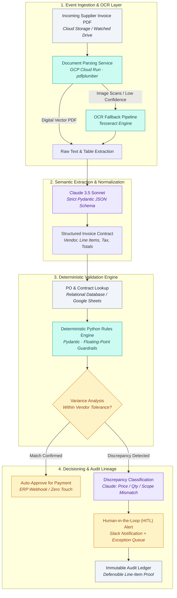

# Autonomous Invoice Reconciliation & Auditing Engine 🧾

[](https://invoice-reconciler-207143040745.europe-west1.run.app/)
[](https://www.python.org/)
[](https://fastapi.tiangolo.com/)
[](https://www.anthropic.com/)
[](https://www.docker.com/)
[](#-the-core-design-neuro-symbolic-architecture)

> **Enterprise Financial Systems Architecture:** A production-grade, neuro-symbolic reconciliation engine that pairs LLM structured tool-calling with deterministic Python validation rules to detect billing discrepancies, recover vendor overcharges, and eliminate manual finance bottlenecks.

Originally architected for an enterprise procurement and accounting department to replace brittle manual reconciliations with an event-driven, auditable validation pipeline.

---

### 📊 Measured Production Impact

* **~35% Spend Reduction:** Detected subtle vendor billing anomalies, unapplied discounts, and line-item markup drift that bypassed human review.
* **~48% Overcharges Recovered:** Provided defensible, auditable calculation logs used directly in vendor dispute resolution.
* **~70% Cycle-Time Reduction:** Slashed end-to-end review latency from days of manual spot-checking down to automated, near-instantaneous reconciliation.
* **Zero Math Hallucinations:** 100% of financial calculations, tolerance bands, and contract caps enforced via deterministic Python.

---

## 💡 The Core Design: Neuro-Symbolic Architecture

Financial systems have zero tolerance for non-determinism. Large Language Models excel at semantic comprehension but are fundamentally unsuited for financial arithmetic due to precision drift, hallucination risks, and audit compliance constraints.

This system strictly enforces a **Neuro-Symbolic separation of concerns**:

```
┌──────────────────────────────────────┐     ┌──────────────────────────────────────┐
│       NEURAL / LLM SUBSYSTEM         │     │     SYMBOLIC / CODE SUBSYSTEM        │
│  (Claude Structured Tool-Calling)    │     │  (Python · Pydantic · Deterministic) │
├──────────────────────────────────────┤     ├──────────────────────────────────────┤
│ • Ingestion of messy, unstandardized │     │ • Multi-currency rounding & exact    │
│   PDF invoice layouts                │     │   line-item arithmetic               │
│ • Fuzzy entity & vendor resolution   │     │ • Contractual price-cap verification │
│ • Normalization into strict JSON     │     │ • Tolerance band matching (±X%)      │
│ • Semantic discrepancy categorization│     │ • SOX-compliant immutable audit logs │
└──────────────────────────────────────┘     └──────────────────────────────────────┘
```

> **The Architectural Rule:** *The LLM handles the language and layout entropy; deterministic code owns the math, the contract thresholds, and the financial verdict.*

---

## 🏗️ End-to-End System Architecture



---

## ⚙️ Technical Deep Dive

### 1. Strongly Typed Pydantic Schema Contracts
Every parsed invoice must conform to a deterministic Pydantic model before reaching the validation engine. If an extraction fails schema constraints, it is rejected upstream before touching financial databases:

```python
from pydantic import BaseModel, Field
from typing import List, Optional
from decimal import Decimal

class LineItem(BaseModel):
    item_code: Optional[str] = Field(None, description="SKU or product code")
    description: str = Field(..., description="Line item description")
    quantity: Decimal = Field(..., gt=0, description="Quantity billed")
    unit_price: Decimal = Field(..., ge=0, description="Unit rate")
    line_total: Decimal = Field(..., description="Quantity * Unit Price")

class InvoiceExtractionContract(BaseModel):
    invoice_number: str
    vendor_name: str
    invoice_date: str
    currency: str = Field(default="USD")
    subtotal: Decimal
    tax_amount: Decimal = Decimal("0.00")
    total_amount: Decimal
    line_items: List[LineItem]
    confidence_score: float = Field(..., ge=0.0, le=1.0)
```

### 2. Deterministic Arithmetic & Tolerance Verification
Financial math uses Python's `Decimal` type to eliminate floating-point approximation errors. Discrepancy checks evaluate unit price variances, quantity discrepancies, and contractual tolerance caps:

$$\text{Variance} = |\text{Invoice Total} - \text{PO Expected Total}|$$
$$\text{Is Acceptable} \iff \text{Variance} \le (\text{PO Total} \times \text{Vendor Tolerance Band}) \land (\text{Unit Price} \le \text{Contract Cap})$$

---

## 🛠️ Technology Stack

| Layer | Component | Technical Justification |
| :--- | :--- | :--- |
| **Compute & Microservices** | GCP Cloud Run (Docker) | Serverless container execution with scale-to-zero economics, eliminating idle costs during off-peak hours. |
| **Language & Backend** | Python 3.11, FastAPI | Asynchronous I/O, native support for scientific computing, and sub-millisecond route handling. |
| **Semantic Extraction** | Anthropic Claude 3.5 Sonnet | State-of-the-art context window and adherence to structured JSON schemas with lowest hallucination rates. |
| **Data Contracts** | Pydantic v2 | High-performance C-based data validation and enforcement of deterministic schemas. |
| **OCR & Document Parsing** | pdfplumber + Tesseract OCR | Hybrid vector PDF text extraction with automatic fallback for degraded scans and physical faxes. |
| **Orchestration & Workflow** | n8n (Self-Hosted on GCP) | Visual state machine management, webhook event triggers, and observable execution lineage. |
| **Audit & Persistence** | PostgreSQL / Google Sheets | Dual-mode persistence enabling direct finance operator interaction alongside relational data storage. |
| **Secrets & Security** | Google Secret Manager | Zero-trust credential isolation; zero API keys stored in environment variables or code repositories. |

---

## 🔒 Enterprise Governance, Privacy & Compliance

* **Air-Gapped Processing:** Sensitive financial and vendor tax IDs are sanitized before external model routing.
* **Audit Lineage:** Every automated decision generates a structured audit log containing the raw PDF hash, extracted JSON, expected PO snapshot, and exact delta calculation for regulatory inspection (SOX-readiness).
* **Human-in-the-Loop (HITL) Fallback:** Ambiguous line-item descriptions or extractions with confidence scores below 0.85 bypass auto-approval and are routed directly to human bookkeepers with pre-highlighted diffs.

---

## 📂 Repository Structure

```
├── invoice-reconciliation-agent.json  # Orchestration workflow graph (n8n JSON specification)
├── README.md                          # Enterprise technical architecture and specifications
└── LICENSE                            # MIT License
```

---

## 🚀 Deployment & Configuration

### Prerequisites
* Docker and Python 3.11+
* GCP Account (Cloud Run, Secret Manager)
* Anthropic API Key (Claude 3.5 Sonnet)
* n8n instance (Self-hosted or Cloud)

### Quickstart Setup
1. **Import Orchestration Graph:** Import `invoice-reconciliation-agent.json` into n8n (**Workflows → Import from File**).
2. **Provision Credentials:** Configure Google Cloud service account keys, Claude API tokens, and Slack webhooks in Google Secret Manager or n8n credentials.
3. **Deploy Microservices:** Containerize the Python parsing and reconciliation services onto GCP Cloud Run:
   ```bash
   gcloud run deploy invoice-parser --source. --platform managed --allow-unauthenticated
   ```
4. **Trigger Testing:** Upload a sample supplier invoice PDF to the designated watched storage bucket or Drive folder to observe real-time end-to-end reconciliation.

---

## 👤 Author

**Amanda Hervol**  
*Enterprise Applied AI Engineer & Solutions Architect*  
[GitHub Profile](https://github.com/amandahervol-alt) • [LinkedIn](https://www.linkedin.com/in/amandaa-hervol/) • [Live Cloud Run Demo](https://invoice-reconciler-207143040745.europe-west1.run.app/)
